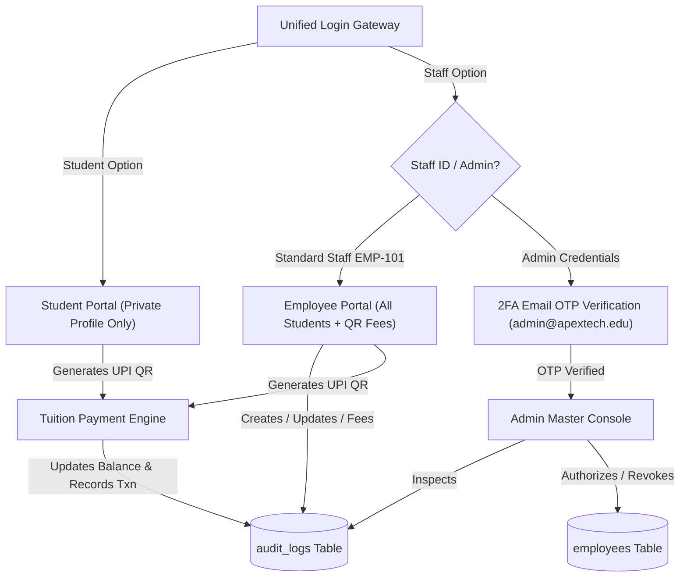

# Student Management System (SMS v2.5 Enterprise)

[](https://www.oracle.com/java/)
[](#)
[](#)
[](#)
[](LICENSE)

Engineered as an enterprise-grade academic administration platform featuring a **Tri-Portal Role-Based Access Control (RBAC) Architecture** (Admin, Employee, and Student), live database modification audit trails, dynamic amount-encoded UPI QR code fee settlements, and a stealth 2FA Email OTP administrative gateway.

---

## 🌟 Core System Highlights (11-Point Architectural Specification)

1. **Tri-Portal Role-Based Access Control (RBAC)**:
   - **Admin (Super Administrator)**: Full root authority over all university data. Live audit trail logging every modification event (`INSERT`, `UPDATE`, `FEE_COLLECTION`, `DELETE`) with exact employee attribution. Management and authorization of staff accounts.
   - **Employee (Staff / Counselor / Accountant)**: Full visibility into all students across departments. Capability to register new admissions, edit student profiles/credentials, and collect fees with dynamic UPI QR generation.
   - **Student (Restricted Private Profile)**: Completely isolated view showing **only their own profile**. Strictly prevented from viewing other students or modifying their login ID/password. Can submit tuition fees using their credentials.

2. **Stealth Administrative 2FA Email OTP Gateway**:
   - The Admin console is deliberately omitted from public portal listings.
   - Admin accesses the system by entering superuser credentials (`admin` / `admin123`) inside the **Staff Login Portal**.
   - Upon verification of credentials, a **6-Digit One-Time Password (OTP)** is dispatched to `admin@apextech.edu`. Only correct OTP input grants entry to the Admin Master Console.

3. **Academic Department Segmentation**:
   - Students are partitioned into faculties:
     - *Computer Applications (BCA)*
     - *Management Studies (BBA)*
     - *Commerce & Accounts (B.Com)*
     - *Information Technology (MCA)*
   - Employees can filter by department or fee status (`PAID` / `DUE`) with instant live search.

4. **Dynamic Amount-Encoded UPI QR Code Engine**:
   - Adheres to NPCI specifications: `upi://pay?pa=fees@citycollege.edu&pn=City+College+of+Management&am={AMOUNT}&cu=INR&tn={ROLL}_{HEAD}`.
   - Dynamic canvas generation allows employees and students to enter custom fee amounts (e.g. ₹25,000) and scan via Google Pay, PhonePe, or Paytm for instant receipt generation and balance deduction.

5. **Student Credential Governance & Immutability**:
   - Every student's Login ID and Password are visible to and managed by authorized employees to assist in password recovery.
   - Students have read-only access to their credentials; changing their Login ID or Password from the student interface is strictly prohibited.

6. **Admin-Authorized Employee Accounts**:
   - Each staff member has unique credentials authorized directly by Admin, tagged with their respective department and role.

---

## 🔑 Demo Access Credentials & Default Passwords

> [!IMPORTANT]
> **Stealth Admin 2FA Gateway**: To access the Super Admin Master Console, navigate to the **Staff Portal**, enter `admin` / `admin123`, and enter the 2FA Email OTP **`849201`** (dispatched to `admin@apextech.edu`).

| Role | Portal Entry | Login ID / Username | Password | 2FA OTP Requirement | Capabilities |
| :--- | :--- | :--- | :--- | :--- | :--- |
| **Super Admin** | *Staff Portal (Stealth)* | **`admin`** | **`admin123`** | **`849201`** (Dispatched to `admin@apextech.edu`) | Full root access, live audit trail, staff account approval |
| **Employee 1** | Staff Portal | **`EMP-101`** | **`staff123`** | None | View all students across departments, view student passwords, register students, submit UPI QR fees |
| **Employee 2** | Staff Portal | **`EMP-102`** | **`staff123`** | None | Department filtering, fee collection |
| **Student 1** | Student Portal | **`BCA2026-001`** | **`pass123`** | None | Isolated private profile for *Aarav Sharma*, self-fee payment via UPI QR |
| **Student 2** | Student Portal | **`BCA2026-002`** | **`pass123`** | None | Isolated private profile for *Rohan Verma* |

---

## 🖥️ Standalone Browser Demo & Quick Execution

A fully responsive, interactive zero-dependency browser client is pre-packaged in the repository root:
- **Instant Browser Launcher**: Open `demo/index.html` directly in any web browser.
- **Direct File Path**: [demo/index.html](file:///C:/Users/KRIN/.gemini/antigravity/scratch/02-student-management-system/demo/index.html)

---

## 🏗️ Architecture & Audit Flow



---

## 📦 Database Setup & Migration

```bash
# Initialize MySQL 8.0 schema with seed data
mysql -u root -p < schema.sql
```

The database initializes 6 core relational tables:
- `departments`: Academic division metadata
- `employees`: Admin-authorized staff credentials
- `admin_credentials`: Root administrator account and 2FA configuration
- `students`: Student master records with immutable passwords and fee balances
- `audit_logs`: Live chronological log of all database updates
- `fee_transactions`: UPI settlement history with operator attribution

---

## 💡 Key Technical Viva / Interview Q&A

1. **How is the Admin portal kept secure and hidden from public visitors?**
   * *Answer*: By omitting the admin portal from top navigation menus and requiring superuser authentication via the Staff portal followed by a mandatory 2-Factor Authentication (2FA) Email One-Time Password (OTP).
2. **Why are student credentials visible to employees but immutable to students?**
   * *Answer*: University administration requires staff to perform verified password resets and identity verification. Preventing students from changing their Student ID and password eliminates identity tampering and unauthorized account swapping.
3. **How does the Dynamic UPI QR Code Fee engine work?**
   * *Answer*: Using the standard National Payments Corporation of India (NPCI) UPI deep-link URI format: `upi://pay?pa={MERCHANT_VPA}&pn={COLLEGE_NAME}&am={AMOUNT}&cu=INR&tn={STUDENT_ROLL_NO}` rendered onto an HTML5 canvas.
4. **How does the live Audit Trail track employee modifications?**
   * *Answer*: Every write operation (`INSERT`, `UPDATE`, `FEE_COLLECTION`) inserts a record into the `audit_logs` table containing the timestamp, acting employee ID, affected student roll number, and state difference.
5. **How is student privacy preserved?**
   * *Answer*: Student authentication binds the session strictly to their roll number (`session.roll_no`), rendering an isolated view that cannot query or enumerate records of other students.

---

## 📄 License & Open-Source

This project is open-source and licensed under the [MIT License](LICENSE). Built for production-ready academic administrative architecture showcases.
